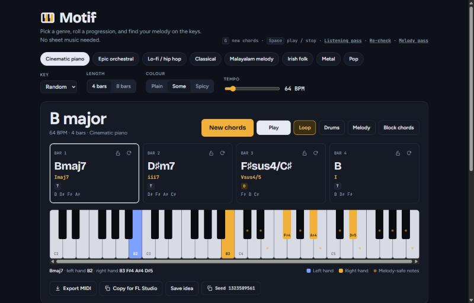

# Motif

An idea generator for songwriters who play by ear. Pick a genre, get a chord progression that follows real harmony rules, see it on a keyboard, hear it with sampled instruments, get a melody starter, and export it as MIDI to your DAW.



## Why

I play keyboard by ear and produce in FL Studio. The hard part is never the skill. It is the blank page. Motif gives me a musically sensible starting point in one click, shows exactly which keys to press, and gets out of the way.

Every musical output is shown as keys and note names (C4, E♭3), not only as notation.

## Features

- **8 genres:** cinematic piano, epic orchestral, lo-fi / hip hop, classical, Malayalam melody, Irish folk, metal and pop. Each genre is a JSON profile with its own modes, tempo range, idioms, cadences, voicing style and melody vocabulary.
- **Progressions that follow harmony rules.** Each chord card shows the chord symbol, the roman numeral, the harmonic function (T, PD or D), the notes, and a marker for borrowed chords. Known idioms, such as the Andalusian cadence, are named.
- **Colour control:** Plain, Some or Spicy sets how many extensions and borrowed chords appear.
- **Lock and swap:** lock the chords you like, then regenerate the rest, or swap one chord so that it still fits its neighbours.
- **Keyboard view:** left hand and right hand in different colours, with the voicing engine choosing smooth voice leading.
- **Sampled instruments:** piano, electric piano, orchestral instruments and drum machines, with comping patterns and drums for each genre.
- **Melody starter:** a melody built from a motif and developed over the phrase, shown as a piano roll and as note names. The Malayalam genre writes melodies in a raga (arohana and avarohana) with gamaka grace notes.
- **Scale panel:** the best-fit scale for the progression and its raga cousin.
- **Export:** multi-track MIDI (chords, bass, melody, drums, with tempo and key signature) and a "Copy for FL Studio" text summary.
- **Saved ideas** in IndexedDB, with JSON export and import.
- **Seeds:** every idea has a seed, so the same seed and settings give the same idea again.

## How it works

### Theory engine

The theory code is pure TypeScript: no DOM, no audio and no `Math.random()`. Every generator takes a seeded random source, so every result can be reproduced and tested.

- **Progressions:** the engine makes 24 candidates, either from a weighted chord-transition walk or from a known idiom. It applies a cadence, adds colour, and scores each candidate against rules such as function order, bass motion and no repeats of recent ideas. A softmax picks one candidate, so the best score usually wins, but not always.
- **Roman numerals:** an own parser, where lowercase means minor (`vi` is A minor in C major). Off-the-shelf parsers got this wrong.
- **Melodies:** a 2-bar motif developed over the form. The engine checks 16 candidates against hard rules (strong beats on chord tones, steps that resolve, range) and scores them.
- **Data:** for pop, metal and lo-fi, the transition weights blend hand-written tables with statistics from the [Chordonomicon](https://huggingface.co/datasets/ailsntua/Chordonomicon) dataset of 666,000 songs. A build script (`npm run tables`) estimates the key of each song section and counts chord transitions.

### Audio

Tone.js is the clock and smplr plays the samples. Both share one AudioContext. All sound is scheduled through transport callbacks, never `setTimeout`. A timing harness checked this in Chrome: 300 of 300 bars played on time over 10 minutes.

### Layers

npm workspaces: the app in `apps/web`, the music code in `packages/core`, the API server (Hono) in `apps/server`, and the API contract (Zod schemas) in `packages/protocol`.

```
apps/web     src/ui/      React components (thin)
               │
             src/state/   Zustand store
               │      ╲
               │     src/audio/   the only code that touches the AudioContext
               ▼
packages/core  idea.ts and theory/: pure, seeded, fully unit-tested
```

## Stack

Vite · React 19 · TypeScript · Zustand · Tone.js · smplr · tonal (note spelling only) · @tonejs/midi · Vitest

There are 580 tests, including property tests for the theory rules and golden-seed snapshots that catch unintended changes in the generated music.

## Run it

You need Node 22.18 or later.

```bash
npm install
npm run dev
```

`npm run dev` starts the web app and the API server. The API server needs `apps/server/.env`. Copy `apps/server/.env.example` to that file, then make an invite code:

```bash
npm run new-code -w @motif/server -- yourname
```

Put the printed `name:code` line in `INVITE_CODES`. The app works without the API server, but the AI chat (coming soon) needs it.

| Command | What it does |
|---|---|
| `npm run dev` | Start the web dev server and the API server |
| `npm run new-code -w @motif/server -- <name>` | Make an invite code for a person |
| `npm test` | Run the test suite |
| `npm run typecheck` | Type-check every workspace |
| `npm run lint` | Lint |
| `npm run build` | Build for production |
| `npm run tables` | Rebuild the transition tables (needs the Chordonomicon CSV, see `docs/THEORY.md` §7) |

## Roadmap: an AI producer

The next step is a chat where you describe what you want, for example "sad but hopeful, like a slow Malayalam film song", and an AI producer builds and refines the idea.

The AI does not write the music. The theory engine stays the source of truth. The model reads the request, calls the engine's functions as tools (generate an idea, change a chord, write a new melody), checks the results, and explains its choices. Follow-ups such as "make it darker" change the current idea instead of starting over.

The plan: a Node and Hono backend, an own provider-neutral model layer on the Gemini API, Zod-validated tools, a streaming chat UI, an eval set, then Postgres and deploy. The full spec is in [.plans/ai-producer-spec.md](.plans/ai-producer-spec.md).

## Docs

- [docs/SPEC.md](docs/SPEC.md): features, architecture, milestones and backlog
- [docs/THEORY.md](docs/THEORY.md): rules for the progression, voicing and melody engines, genre profiles and ragas
- [docs/AUDIO.md](docs/AUDIO.md): audio engine, instrument map and MIDI export
- [docs/decisions.md](docs/decisions.md): each design decision and the reason for it
- [docs/progress/LOG.md](docs/progress/LOG.md): build log, newest first
- [prototype/chord-spark.html](prototype/chord-spark.html): the single-file v0 prototype that started the project

## Credits and licence

Sample and data sources, with their licences, are listed in [CREDITS.md](CREDITS.md). Because the Chordonomicon data is licensed CC BY-NC 4.0, Motif is a non-commercial project.

The code is public to read. No open-source licence is granted yet, so all rights are reserved.
